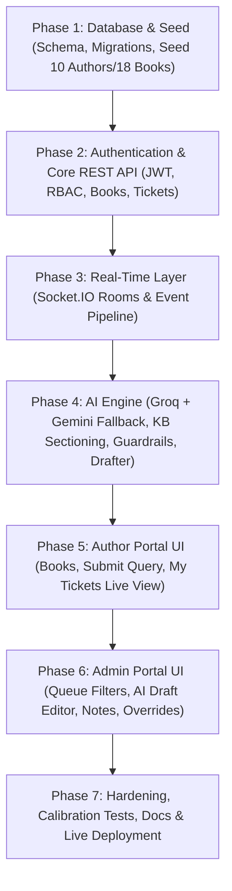

# BookLeaf Author Support Portal — Development Roadmap & Implementation Plan

> **Memory & Guide Reference:** All tasks strictly adhere to the architecture, canonical keys, security guidelines, and evaluation criteria defined in `rules.md`.

---

## Evaluation Weighting & Strategy
- **AI Integration Quality (25%):** Sectioned Knowledge Base, pre-computed facts, deterministic guardrails, draft caching, graceful degradation, and token efficiency.
- **Architecture & Code Quality (25%):** Strict layering (`routes → controllers → services → db/ai`), clean abstractions, parameterised SQL, centralized error handling.
- **API Design (15%):** RESTful endpoints, role-based access control, Zod schema validation, consistent error envelope.
- **Functionality & Completeness (15%):** Real-time Socket.IO sync, full ticket lifecycle, handling all dataset edge cases.
- **Product Thinking (10%):** Practical UX for authors and ops, sensible defaults, urgent/old ticket highlighting.
- **Documentation & Communication (10%):** Detailed README, API reference, AI evidence, 1-page design write-up.

---

## Step-by-Step Implementation Phases

---

### Phase 1: Database Design, Schema & Seed Script (Completed)
- [x] **1.1 Database Schema (`server/src/db/schema.sql`):**
  - `users`: `id`, `author_code`, `name`, `email` (lowercased), `phone`, `city`, `role` (`author` | `admin`), `password_hash`, `created_at`.
  - `books`: `id`, `book_code` (e.g. `BK001`), `author_id` (FK), `title`, `isbn`, `genre`, `publication_date` (nullable for production), `status`, `mrp` (nullable), `author_royalty_per_copy` (nullable), `total_copies_sold`, `total_royalty_earned`, `royalty_paid`, `royalty_pending`, `last_royalty_payout_date` (nullable), `print_partner` (nullable), `available_on` (text[]), `created_at`.
  - `tickets`: `id`, `author_id` (FK), `book_id` (FK, nullable for account-level), `subject`, `description`, `attachment_name` (UI only), `status` (canonical enum), `category` (canonical enum), `category_source`, `priority` (canonical enum), `priority_source`, `ai_status`, `ai_reason`, `assigned_to` (FK to admin), `created_at`, `updated_at`.
  - `ticket_messages`: `id`, `ticket_id` (FK), `sender_id` (FK), `body`, `created_at`.
  - `internal_notes`: `id`, `ticket_id` (FK), `author_id` / `admin_id` (FK), `note`, `created_at` (isolated table to ensure no author leakage).
  - `ai_drafts`: `id`, `ticket_id` (FK), `draft_text`, `model`, `tokens_used`, `created_at`.
  - Add indexes: `tickets(author_id)`, `tickets(status, priority, created_at)`, `ticket_messages(ticket_id, created_at)`, `books(author_id)`.
- [x] **1.2 Migration Runner (`server/src/db/migrate.js`):**
  - Reads and executes `schema.sql` idempotently inside a transaction.
- [x] **1.3 Idempotent Seeding Script (`server/src/db/seed.js`):**
  - Truncates and resets tables in a transaction.
  - Inserts 10 authors and 18 books from `server/data/bookleaf_sample_data.json`.
  - Handles production-stage books (`BK013`, `BK015` with null MRP, null pub dates).
  - Hashes passwords using bcrypt (`Author@123` and `Admin@123`).
  - Creates admin accounts (`admin@bookleaf.in`).
  - Reports verification counts upon completion.

---

### Phase 2: Authentication & Core REST API (Completed)
- [x] **2.1 Auth Module (`/api/auth`):**
  - `POST /api/auth/login`: validate credentials, issue JWT with `id` and `role`. Uniform error messages for security.
  - `GET /api/auth/me`: returns authenticated user profile.
  - Middleware: `authenticateToken`, `requireRole('admin')`.
- [x] **2.2 Books API (`/api/books`):**
  - `GET /api/books`: Author gets their own books. Admin can view all or filter by `authorId`.
- [x] **2.3 Tickets API (`/api/tickets`):**
  - `POST /api/tickets`: Author creates ticket. Validates book ownership if `bookId` is supplied. Saves to DB immediately with `ai_status = 'pending'`.
  - `GET /api/tickets`: Author gets only their own tickets. Admin gets full queue with query filters (`status`, `category`, `priority`, date ranges).
  - `GET /api/tickets/:id`: Author gets their ticket (returns 404 if accessed by another author). Admin gets full ticket with AI metadata.
  - `POST /api/tickets/:id/messages`: Authors and Admins post thread replies.
  - `PATCH /api/tickets/:id`: Admin overrides status, category, priority, or assignee (sets `*_source = 'admin'`).
  - `GET /api/tickets/:id/notes` & `POST /api/tickets/:id/notes`: Internal admin notes (strict role protection).

---

### Phase 3: Real-Time Synchronization (Socket.IO) (Completed)
- [x] **3.1 Socket Handshake Authentication:**
  - Authenticate socket handshake using JWT. Reject invalid/expired tokens.
- [x] **3.2 Room Architecture:**
  - Author joins private room `user:<userId>`.
  - Admins join shared room `admins`.
- [x] **3.3 Event Emission Pipeline:**
  - Post-DB-write triggers:
    - New ticket created -> emits `ticket:created` to `admins`.
    - Message sent -> emits `message:new` to `user:<authorId>` and `admins`.
    - Status/Priority update -> emits `ticket:updated` to both author and `admins`.
    - AI classification done -> emits `ai:classified` to `admins`.
  - Payload hygiene: never include internal notes in author room payloads.

---

### Phase 4: AI Engine & Intelligence Layer (Completed)
- [x] **4.1 AI Provider Interface (`server/src/ai/providers/`):**
  - Pluggable provider abstraction with uniform interface.
  - Primary provider: Groq (`openai/gpt-oss-120b`).
  - Fallback provider: Google Gemini (`gemini-1.5-flash` or `gemini-2.0-flash`).
  - Request timeout via `AbortController` (15s) and automatic single retry on 429/5xx.
- [x] **4.2 Modular Knowledge Base (`server/src/ai/knowledgeBase/`):**
  - Separate structured files: `companyOverview.js`, `royaltyPolicy.js`, `isbnPolicy.js`, `printingQuality.js`, `distributionAvailability.js`, `productionStages.js`, `toneGuidelines.js`.
- [x] **4.3 Auto-Classification & Priority Scoring (`classifier.js`):**
  - Fast prompt returning strict JSON `{ category, priority, reason }`.
  - Zod parsing and validation of AI output.
  - Deterministic guardrails: ISBN errors always >= High; legal threats = Critical; severe royalty delays = High/Critical; bio/minor updates = Low.
  - Runs in background after ticket creation without blocking author response.
  - Admin override protection (AI will never overwrite fields marked `source = 'admin'`).
- [x] **4.4 AI Response Drafter (`drafter.js`):**
  - Generated on-demand when an admin views the ticket.
  - Token-smart context: only the specific KB section for the category + relevant book's computed facts.
  - Computed facts injected deterministically (e.g. next quarterly payout date = quarter end + 45 days, below 1000 threshold rollover notice, exact production stage).
  - Drafts cached in `ai_drafts` with Regenerate option.
  - Plain-text email tone with empathy, clear timelines (e.g. 48h escalation), and next steps.
- [x] **4.5 Graceful Degradation:**
  - If AI fails: ticket is saved with default category/priority, `ai_status = 'failed'`, and admin is given a manual reply interface with a Retry button.

---

### Phase 5: Author Portal Frontend (React + Vite + Tailwind CSS) (Completed)
- [x] **5.1 Auth State & Session Management:**
  - `AuthContext`: login, logout, token persistence, auto session restoration via `/api/auth/me`.
  - `ProtectedRoute`: redirect unauthorized users to login.
- [x] **5.2 My Books View:**
  - Data table with title, ISBN, genre, pub date, status, MRP, copies sold, royalty earned, paid, and pending.
  - Formatted currency (Indian number grouping: INR).
  - Edge case handling: "In Production - Cover Design" (no sales/null fields rendered cleanly), rollover alerts for pending under 1000 threshold.
- [x] **5.3 Submit Support Query View:**
  - Book selection dropdown ("General / Account Level" as default first option).
  - Subject and description inputs with client-side validation.
  - UI-only file attachment picker with selected filename display and "UI only" note.
- [x] **5.4 My Tickets & Real-Time Conversation:**
  - Ticket list with status badges (`Open`, `In Progress`, `Resolved`, `Closed`).
  - Conversation thread with instant real-time message arrival via Socket.IO without page refresh.
  - Empty, loading, and error states.

---

### Phase 6: Admin Portal Frontend (Completed)
- [x] **6.1 Admin Ticket Queue:**
  - Multi-column table: Subject, Author Name, Book, Category, Priority, Status, Assignee, Age.
  - Filters: Status, Category, Priority, Date range, and Search (persisted in URL query params).
  - Visual distinction: urgent & oldest unresolved tickets highlighted at the top.
  - AI pending / failed indicator tags.
- [x] **6.2 Ticket Detail & Management View:**
  - Full author query context and linked book facts sidebar.
  - Inline controls to override Status, Category, and Priority with source indicators (`AI` vs `Admin`).
  - Assign-to-me quick button.
- [x] **6.3 AI Draft Workspace:**
  - Editable textarea pre-filled with the AI draft.
  - Action buttons: Send Reply (updates author thread live), Regenerate Draft, Discard.
  - Fallback message & manual composition mode when AI is unavailable.
- [x] **6.4 Internal Notes (Secure):**
  - Distinctly styled section clearly marked *"Internal only - not visible to author"*.
  - Independent note logging and history.

---

### Phase 7: Verification, Hardening & Documentation (Completed)
- [x] **7.1 Acceptance Calibration Testing:**
  - Run the 7 sample queries from `rules.md` through the drafter; save inputs and outputs in `docs/calibration_results.md`.
- [x] **7.2 Security & Chaos Verification:**
  - RBAC verification (author forbidden on admin routes, 404 on cross-author tickets).
  - Break API key intentionally to verify graceful degradation.
- [x] **7.3 API Documentation:**
  - Complete endpoint documentation covering requests, responses, status codes, and error formats.
- [x] **7.4 One-Page Design Write-Up (`docs/WRITEUP.md`):**
  - Architectural priorities, trade-offs, and future production roadmap (BullMQ worker queues, Redis Socket.IO adapter, S3 attachments, observability).
